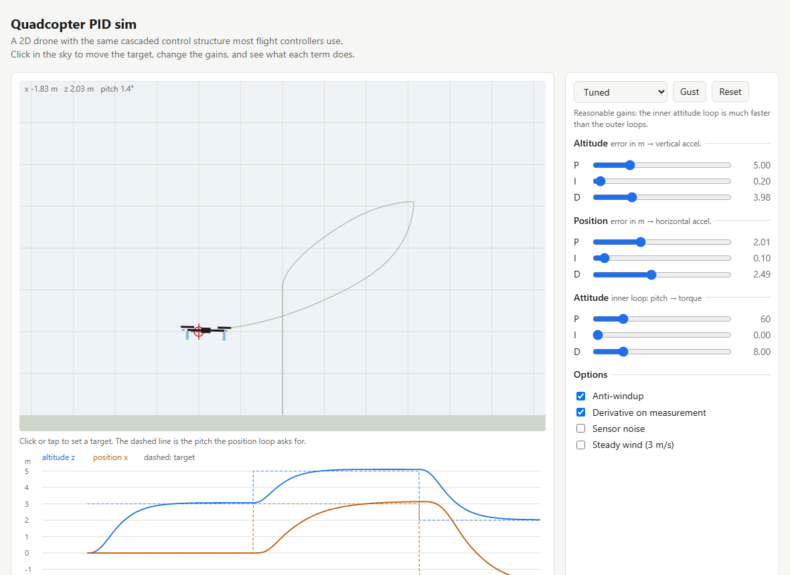

# quadcopter-pid-sim

*Built with the help of Claude Code.*

A 2D quadcopter you can tune in the browser. Click in the sky to move the
target, drag the gain sliders, add wind or sensor noise, and watch what each
term of each controller does.

**[Try it live](https://wizzardofodds.github.io/quadcopter-pid-sim/)**, no
install needed.



## What's inside

**The drone.** A rigid body in the x–z plane with two rotors (a planar
quadcopter): mass 1.2 kg, thrust-to-weight about 2, linear air drag, and
rotors that take 40 ms to spin up. That lag matters: it is what makes an
overly aggressive attitude controller oscillate. Physics runs at 1 kHz.

**The controller.** A cascade, like most real flight controllers
(PX4, ArduPilot, Betaflight):

```
altitude error  ──PID──▶ vertical accel ──┐
                                          ├─▶ collective thrust ─┐
position error  ──PID──▶ horizontal accel ─▶ pitch to hold        ├─▶ mixer ─▶ left / right rotor
                                    pitch error ──PID──▶ torque ─┘
```

The outer loops never touch the rotors. They decide how the drone *should* be
tilted, and the inner attitude loop makes it so. This only works if the
inner loop is several times faster than the outer ones, which is what the
"Slow inner loop" preset demonstrates. Control runs at 200 Hz.

**The PID** (`src/pid.js`) has the three details a textbook PID leaves out:
- derivative on the measurement, not the error, so a new target doesn't cause a spike
- a low-pass filter on the derivative, because differentiating noise amplifies it
- anti-windup: the integrator pauses while the output is saturated

## Presets

| preset | what to look for |
|---|---|
| Tuned | about 2 % overshoot on altitude, settles in about 2 s |
| No derivative | nothing damps the motion: big overshoot, then ringing |
| Slow inner loop | the drone tilts too late, the position loop overcorrects, and it wobbles |
| Too aggressive | attitude gain 5× too high: with the rotor lag, a fast sustained wobble |
| Integral windup | anti-windup off: the climb saturates the rotors, the integral keeps growing, and altitude overshoots by about 100 % (about 30 % with anti-windup on) |

The last two are easy to make worse: turn on sensor noise, or switch off
"derivative on measurement" and click a new target.

## Run locally

It's static HTML and ES modules, with no build step. Modules need a web
server, not `file://`:

```
python -m http.server 8000
# open http://localhost:8000/        (add ?demo for a scripted flight)
```

## Tests

`tests/cases.js` flies the drone headlessly and checks behaviour: hover
holds, altitude and position steps settle, removing D increases overshoot,
anti-windup limits the climb overshoot, the drone recovers from a gust, and
the PID details above work as described.

```
npm test                 # Node 18+
```

or open `tests/index.html` through the local server to run the same cases in
the browser.
